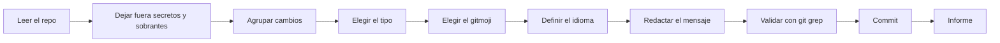

<div align="center">

# gitmoji-commits

**Un skill para agentes que escribe commits como lo haría un desarrollador con experiencia.**

gitmoji + Conventional Commits · cualquier idioma · sin dependencias · Linux, macOS y Windows

[](https://github.com/CXmiloxx/gitmoji-commits/releases/latest)
[](LICENSE)
[](https://skills.sh)
[](#compatibilidad)
[](#compatibilidad)

[English](README.md) · [Español](README.es.md) · [Changelog](CHANGELOG.md)

</div>

```
npx skills add CXmiloxx/gitmoji-commits
```

---

## Antes y después

Lo que un agente suele commitear:

```
Update files and fix bug

- Modified src/components/LoginForm.tsx
- Updated package.json
- Fixed bug in auth

🤖 Generated with AI
Co-Authored-By: AI Assistant <noreply@example.com>
```

Lo que commitea con **gitmoji-commits**:

```
🐛 fix(auth): sesiones cerradas al cambiar la contraseña

Cambiar la contraseña dejaba abiertas las sesiones en otros dispositivos,
así que una sesión robada seguía funcionando. Ahora todas las sesiones
activas terminan cuando cambia la contraseña.
```

Una intención por commit. Un título que dice qué cambió. Un cuerpo que explica por qué importa. Sin listas de archivos ni firmas de IA.

## Características

| | |
|---|---|
| 🧭 **Se adapta al repositorio** | Lee el historial reciente para saber el idioma, los scopes y el estilo de emoji que ya usas. Los pares incorrectos del historial no se copian. Si hay commitlint o una convención escrita, sigue eso. |
| 🌍 **Cualquier idioma** | Los commits salen en español, inglés, francés, portugués, alemán o cualquier otro idioma, según el proyecto. |
| 🔤 **Términos de programación en inglés** | *dashboard*, *endpoint*, *deploy* o *token* no se traducen, salvo que lo pidas. |
| 🌳 **Decide el tipo** | Diez preguntas de sí/no sobre las rutas modificadas y el diff, gana la primera, y distinguen `feat`, `fix`, `refactor`, `perf`, `style`, `docs`, `test`, `build`, `ci`, `chore` y `revert`. |
| 😀 **Los 75 gitmojis** | Cada gitmoji pertenece a un solo tipo, y los pocos que admiten un segundo llevan escrita la condición literal que lo permite. Primero se decide el tipo y el gitmoji sale solo de la lista permitida para ese tipo, así que un `feat` solo lleva ✨ y nunca acaba con un 🗃️ o un 🐛. El título se verifica antes y después del commit. |
| 📦 **Agrupa los cambios** | Divide lo pendiente en commits de una sola intención, en orden lógico, por intención y nunca por capa. Los tests y la documentación van con el cambio al que pertenecen. |
| 🔐 **Cuida lo que se sube** | Detecta tokens, claves, contraseñas y cadenas de conexión escritas en el código, y deja fuera los `.env`, las notas de sesión, los logs, los dumps y otros archivos sobrantes. Te dice qué dejó fuera y por qué. |
| 🚫 **Sin firmas de IA** | Ni `Co-Authored-By` de herramientas de IA, ni «Generated with», ni 🤖. |
| ✅ **Lo valida git** | Antes de cada commit se ejecutan tres comprobaciones con `git grep` sobre el mensaje: la forma del título y el par tipo–gitmoji, el contenido prohibido (créditos de IA, verbos al inicio, encabezados en el cuerpo) y las advertencias (líneas de más de 72, «ver X», términos inventados en la sesión). Mismo resultado en cualquier sistema. |
| 🧾 **Salida predecible** | Un plan antes de varios commits y el mismo informe corto al final: commits hechos, archivos dejados fuera y notas. |
| ⚡ **Ahorra tokens** | `SKILL.md` contiene lo que necesita cada commit. Los casos ambiguos, los ejemplos, la división de hunks y los casos especiales viven en archivos aparte que solo se leen cuando aparecen. |
| 💻 **Portable** | Solo necesita `git`. Sin scripts, sin Node, sin Python al usarlo. Funciona en bash, zsh, fish, PowerShell y cmd. |

## Instalación

Con la CLI de [skills](https://skills.sh):

```bash
# en el proyecto actual
npx skills add CXmiloxx/gitmoji-commits

# para todos tus proyectos (nivel usuario)
npx skills add CXmiloxx/gitmoji-commits -g

# para todos los agentes instalados en la máquina
npx skills add CXmiloxx/gitmoji-commits -a '*'
```

Como plugin de Claude Code:

```
/plugin install gitmoji-commits --marketplace CXmiloxx/gitmoji-commits
```

Instalación manual: copia `skills/gitmoji-commits/` en el directorio de skills de tu agente, por ejemplo `.claude/skills/gitmoji-commits/` o `.agents/skills/gitmoji-commits/`. Esa carpeta es el skill completo; el resto del repositorio es documentación y herramientas de mantenimiento.

## Uso

Solo pídele a tu agente que haga el commit:

> haz el commit
> commit this
> divide estos cambios en commits
> prepara los commits para el PR
> mejora este mensaje de commit: "arreglos varios"

Para dejar la convención escrita en el repositorio:

> documenta la convención de commits

El agente genera `COMMIT_CONVENTION.md` a partir de lo que encontró en tu historial.

## Cómo funciona



1. **Leer.** Ejecuta `git status`, las estadísticas del diff y los últimos 20 títulos, y busca reglas existentes (commitlint, `COMMIT_CONVENTION.md`, `CONTRIBUTING`).
2. **Filtrar.** Un `git grep` busca secretos escritos en el código de los archivos modificados. Los archivos secretos por naturaleza y los sobrantes (notas de sesión, logs, temporales, comprimidos, configuración local) no se agregan al staging y se reportan.
3. **Agrupar.** Una intención funcional por commit, el menor número de commits posible.
4. **Tipo.** Diez preguntas de sí/no en orden, gana el primer `sí`: revert → docs → test → ci → build → feat/fix/chore → perf → style → refactor → chore.
   - `feat` ✨: Nueva capacidad.
   - `fix` 🐛 + área: Algo estaba roto (🐛, 🚑️, 🔒️); o funcionaba pero cambió intencionalmente (👔 reglas de negocio, 💄 UI, 🚸 usabilidad, etc.). El gitmoji de área señala *qué* cambió.
   - `refactor` ♻️: Código reorganizado, mismo comportamiento.
   - Otros tipos: perf, style, docs, test, build, ci, chore, revert.
5. **Gitmoji.** Solo después de fijar el tipo. Parte del gitmoji por defecto del tipo y solo puede cambiarlo por otro de la lista permitida para ese tipo, cuando su uso describe la intención de todo el commit y no solo los archivos tocados (base de datos, UI). El par se declara antes de escribir el mensaje y se vuelve a comprobar sobre el título real después del commit.
6. **Idioma.** Por orden de prioridad: lo que pidas, luego el archivo de convención, luego el historial, luego el README y por último el idioma en que escribes.
7. **Mensaje.** Un título que describe el cambio sin empezar con verbo y un cuerpo que explica el porqué y el impacto.
8. **Validar.** Declara el par contra la lista permitida y luego `git grep` revisa el archivo del mensaje con `checks/header.pattern`, `checks/forbidden.pattern` y `checks/review.pattern`.
9. **Commit.** Hace staging selectivo y commitea a través de un archivo UTF-8, para que los emojis lleguen intactos en cualquier sistema. Si un hook falla, se corrige la causa; nunca se salta.
10. **Informe.** Commits hechos, archivos dejados fuera y por qué, y cualquier nota sobre el historial.

## Formato

```
<gitmoji> tipo(scope): título

<cuerpo>
```

| Parte | Regla |
|---|---|
| **gitmoji** | Sale de la lista permitida del tipo. Relevante para la intención del commit, nunca elegido solo por el área. Se usa el carácter del emoji, salvo que el repo use `:shortcodes:`. |
| **tipo** | Uno de los 11 tipos de abajo, siempre en inglés y en minúsculas. |
| **scope** | Un dominio en minúsculas: `auth`, `checkout`, `pedidos`. Nunca un archivo, una clase, una tabla ni un componente. Se reutiliza el del historial cuando encaja. |
| **título** | Qué cambió, sin empezar con verbo, sin punto final y sin repetir el scope. Unos 50 caracteres ideales; máximo 72. |
| **cuerpo** | Qué cambió, por qué y qué impacto tiene, en prosa, con líneas de 72. Se entiende solo con `git log`: nada de "ver X". En cambios grandes se admite una lista corta de comportamientos. |

### Tipos

| Tipo | Por defecto | Semver | Cuándo |
|---|---|---|---|
| `feat` | ✨ | minor | Alguien puede hacer algo que antes no podía |
| `fix` | 🐛 + área | patch | Algo estaba roto, o funcionaba pero cambió intencionalmente (reglas de negocio 👔, UI 💄, usabilidad 🚸, validación 🦺, etc.) |
| `refactor` | ♻️ | — | Código reorganizado sin cambiar el comportamiento |
| `perf` | ⚡️ | patch | Mismo comportamiento, más rápido o más ligero de forma medible |
| `style` | 🎨 | — | Solo formato (espacios, orden de imports, autofix de linter) |
| `docs` | 📝 | — | Documentación y comentarios de código |
| `test` | ✅ | — | Tests, mocks, fixtures, snapshots |
| `build` | 📦️ | — | Sistema de build, empaquetado, dependencias |
| `ci` | 👷 | — | Pipelines de CI/CD |
| `chore` | 🔧 | — | Mantenimiento que no encaja en otro tipo |
| `revert` | ⏪️ | patch | Deshace un commit anterior |

**Por qué `fix` lleva gitmojis de área:** Un cambio a reglas de negocio (👔), estilo de UI (💄) o validación (🦺) no es un arreglo de bug — es un cambio intencional. El gitmoji señala *qué* cambió; el tipo `fix` señala *por qué* existe (algo no funcionaba bien, o cambió la política). Esto publica en el changelog y dispara un salto de versión en herramientas como `semantic-release`.

Un cambio incompatible mantiene su tipo y añade 💥 y `!`:

```
💥 feat(api)!: respuestas paginadas en todos los listados

BREAKING CHANGE: los clientes deben leer los resultados del campo `items`.
```

El catálogo completo — cada gitmoji con su tipo único y, cuando existe, la condición de su único tipo alterno — está en [skills/gitmoji-commits/references/gitmojis.md](skills/gitmoji-commits/references/gitmojis.md).

## Ejemplos

| ❌ Evitar | ✅ Escribir | Por qué |
|---|---|---|
| `✨ feat(auth): agregar login con Google` | `✨ feat(auth): inicio de sesión con cuentas de Google` | no empieza con verbo |
| `🐛 fix(LoginForm.tsx): Arreglado bug.` | `🐛 fix(auth): sesiones cerradas al cambiar la contraseña` | scope de dominio, dice qué bug |
| `♻️ refactor: mejoras` | `♻️ refactor(pedidos): totales calculados en un solo lugar` | concreto, no abstracto |
| `⚡️ perf(pedidos): caché Redis en OrderService` | `⚡️ perf(pedidos): historial más rápido en cuentas grandes` | el efecto, no la implementación |
| `✨ feat(dashboard): nuevas gráficas del dashboard` | `✨ feat(dashboard): ventas mensuales por categoría` | no repite el scope |
| `✨ feat(ventas): resumen en el tablero de control` | `✨ feat(ventas): resumen del mes en el dashboard` | los términos de programación van en inglés |

Las mismas reglas en otros idiomas:

```
✨ feat(billing): invoice export per customer
♻️ refactor(panier): calcul des remises dans un seul service
⚡️ perf(relatorios): exportação sem bloquear a interface
✨ feat(suche): Filter nach Preis und Marke
```

## Compatibilidad

| | |
|---|---|
| **Requisitos** | Solo `git` |
| **Sistemas operativos** | Linux, macOS, Windows |
| **Shells** | bash, zsh, fish, PowerShell, cmd |
| **Agentes** | Claude Code, Cursor, Codex y cualquier otro agente que cargue skills `SKILL.md` |

El mensaje del commit se pasa a través de un archivo UTF-8 (`git commit -F`), así que los emojis llegan intactos incluso en consolas de Windows que manejan mal los argumentos Unicode.

## Preguntas frecuentes

**¿Hace push?**
No. Solo hace commits. Nunca hace push, nunca usa `--no-verify` y nunca modifica con `--amend` un commit que ya se subió.

**¿Qué se niega a commitear?**
Secretos escritos en el código (API keys, tokens, contraseñas, llaves privadas, cadenas de conexión con credenciales) y archivos `.env` o de llaves. También deja fuera los sobrantes: notas o planes en Markdown de una sesión de trabajo que nada enlaza, logs, temporales, dumps, comprimidos, salidas de build y configuración personal. Los reporta con los valores secretos ocultos, sugiere qué añadir a `.gitignore` y nunca borra nada. Solo incluye alguno si lo confirmas expresamente.

**Mi repositorio usa commitlint o una convención propia.**
El skill lee esas reglas primero y las sigue. Tienen prioridad sobre todo lo demás.

**Mi historial usa `:sparkles:` en vez de ✨.**
Mantiene el formato de shortcodes que ya usa tu historial, así el log sigue siendo coherente.

**Mi historial tiene pares como `🗃️ feat` o `📚 docs`.**
El historial decide el formato, nunca el par. Los pares fuera de la lista permitida no se copian, y el agente te avisa una vez. Si tu equipo de verdad quiere uno, escríbelo en un `COMMIT_CONVENTION.md` o en la configuración de commitlint: una regla escrita es lo único que puede pasar por encima de la lista permitida.

**¿Por qué títulos sin verbo («inicio de sesión con Google» en vez de «agregar login con Google»)?**
El título dice qué contiene el commit, no una tarea por hacer. El resultado se lee como un changelog limpio, en cualquier idioma.

**¿Puedo forzar un idioma?**
Sí: «haz el commit en inglés», «commit in Spanish». Lo que pidas siempre tiene prioridad.

**¿Y si el repositorio todavía no tiene commits?**
Usa el idioma del README o el idioma en que escribes, y empieza el historial con `🎉 chore(project): …`.

**¿Por qué sin firma de IA?**
El historial pertenece al proyecto y a quienes lo desarrollan. Las firmas de atribución añaden ruido a cada log, blame y changelog.

## Estructura

```
gitmoji-commits/
├── .claude-plugin/                # manifiestos de plugin y marketplace de Claude Code
├── skills/gitmoji-commits/        # EL skill: la única carpeta que cargan los agentes
│   ├── SKILL.md                   # lo que necesita cada commit: reglas, pasos, lista permitida
│   ├── references/                # se leen solo cuando el caso aparece
│   │   ├── gitmojis.md            # los 75 gitmojis, un tipo cada uno
│   │   ├── types.md               # ejemplos para decidir el tipo, casos ambiguos, pares erróneos
│   │   ├── message.md             # scope, título y cuerpo por tipo, con ejemplos
│   │   ├── splitting.md           # un archivo repartido en varios commits, sin git add -p
│   │   ├── special-cases.md       # hooks, commitlint, revert, amend, merge en curso…
│   │   └── convention-template.md # solo se usa al documentar la convención
│   └── checks/                    # expresiones regulares que el agente ejecuta con git grep
│       ├── header.pattern         # forma del título + pares válidos (generado del catálogo)
│       ├── forbidden.pattern      # nunca debe coincidir
│       └── review.pattern         # advertencias que se corrigen o se justifican
├── tests/                         # casos de prueba para las comprobaciones
├── tools/
│   ├── build_checks.py            # regenera los checks; verifica catálogo, lista, versiones y casos
│   └── link-local.sh              # enlaza el skill instalado con este repositorio
├── README.md
├── README.es.md
└── LICENSE
```

## Contribuir

Los issues y los pull requests son bienvenidos, por ejemplo con un ejemplo mejor, un caso especial que falte o un idioma que las reglas no cubran bien. Los commits de este repositorio siguen el propio skill.

`references/gitmojis.md` es la única fuente de verdad de los pares. Después de cambiarlo, o de cambiar la lista permitida en `SKILL.md`, ejecuta:

```bash
python3 tools/build_checks.py build   # regenera checks/header.pattern
python3 tools/build_checks.py check   # catálogo, lista, patrón y casos de prueba coinciden
```

Para probar tus cambios en tu propio agente sin copiar archivos, ejecuta `tools/link-local.sh`: enlaza `~/.agents/skills/gitmoji-commits` y `~/.claude/skills/gitmoji-commits` con `skills/gitmoji-commits/` de tu repositorio.

La CI ejecuta la misma comprobación en cada push. Python solo hace falta para esta herramienta de mantenimiento, nunca para usar el skill.

## Autor

Camilo Guapacha · [@CXmiloxx](https://github.com/CXmiloxx)

Si este skill te ahorra tiempo, dale una ⭐ al repositorio para que más gente lo encuentre.

## Licencia

[MIT](LICENSE)
